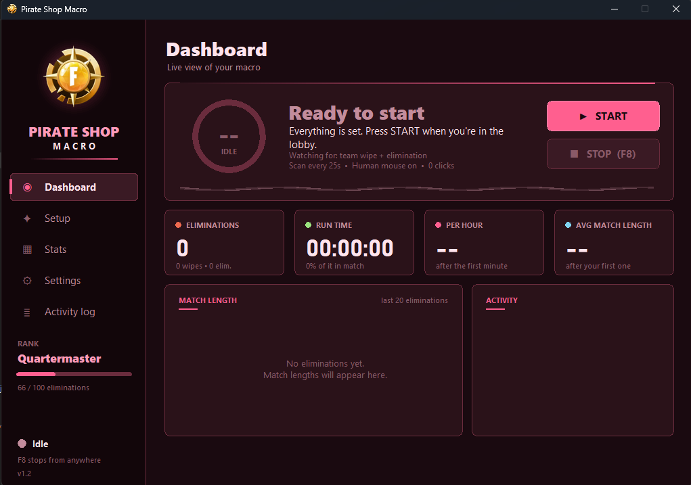

# Pirate Shop Macro

A Windows app that automates the Fortnite ready-up / return-to-lobby loop. It works on
**any graphics card** (no NVIDIA needed), has a built-in screenshot wizard so setup takes
about two minutes, and shows live stats, ranks, and badges.

> **Disclaimer:** This is an unofficial tool, not affiliated with or endorsed by Epic
> Games. Automating gameplay may violate Epic's Terms of Service and accounts can be
> warned, restricted, or banned. Anti-cheat software can also flag simulated input, and
> the human-like mouse movement does **not** guarantee it won't. **Use at your own
> risk**, ideally not on an account you care about. The app only reads your screen and
> sends clicks and key presses. It does not touch game files or memory.



---

## Quick start

1. Install [Python](https://www.python.org/downloads/) and **tick "Add Python to PATH"**
   (3.12 or 3.13 recommended). You only need Python to build the app, one time.
2. Double-click **`Build EXE.bat`**. It takes a few minutes. When the window says
   **SUCCESS**, you'll have **`Pirate Shop Macro.exe`** in the same folder.
3. Double-click **`Pirate Shop Macro.exe`** and click **Yes** on the administrator prompt.
   It opens on the **Setup** page.
4. Press **Capture** next to each step. For every step:
   get that button on screen in Fortnite, press **F9**, then drag a box around it.
5. When every step has a green check, open the **Dashboard** and press **START**.

Stop any time with **F8** (works inside the game) or by moving the mouse to the top-left
corner of the screen.

> **Build failed, or the exe won't open?** Use the backup method instead:
> double-click **`Install Requirements.bat`** once, then double-click
> **`pirate_shop_macro.pyw`**. It's the exact same app. See
> [Backup: run without the exe](#backup-run-without-the-exe).

## How it knows you're out

| Situation | What it looks for | What it does |
|---|---|---|
| Your whole team is eliminated | The **Return to Lobby** button | Clicks it |
| You died but teammates are alive | The **"Eliminated by"** text | Presses Esc, clicks the menu, then Leave Match |

You can turn either one off in **Settings > Detection** if you only want one.

The full loop: click **Ready** > wait > scan every few seconds > leave the match when you're
out > count it > repeat.

## The Setup page (screenshot wizard)

Each step shows a thumbnail once it's captured. Buttons:

- **Capture**: hides the app, waits for you to press **F9** while the button is on screen,
  then lets you drag a box around it. (Press **Capture now** on the little bar if you'd
  rather not use F9.)
- **Test**: checks whether the picture can be found on your screen right now. Make sure
  the button is visible first.
- **Open images folder**: where the pictures live.

| Step | What to capture |
|---|---|
| Ready / Play button | In the lobby, the button you click to start a match |
| "Eliminated by" text | Die with a teammate still alive and capture the text |
| Menu button | Press Esc in a match and capture the menu button you click next |
| Leave Match button | After the menu, the Leave Match button |
| "Return to Lobby" button | When your whole team is out, the Return to Lobby button |
| Extra popup *(optional)* | Any popup you want auto-clicked during a match |

**Tips:** keep the box snug around the button or text (about 100-200 px wide) and avoid
anything that changes (names, numbers, scenery). Capture at the same resolution and UI
scale you play at. If a picture won't match, just **Re-capture** it.

## What's in the app

- **Dashboard:** live status, a countdown ring to the next scan with animated waves,
  eliminations, run time, per-hour rate, average match length, a match-length chart, and
  an activity feed.
- **Setup:** the screenshot wizard above.
- **Stats:**
  - *This session:* run time, eliminations, team wipes vs eliminated, per-hour rate,
    average/fastest/longest match, a time-in-match donut, scans, clicks, ready-ups,
    failures, and your most recent matches.
  - *All time:* totals saved between runs, best session, longest session, a last-7-days
    chart, and a busiest-hours chart.
  - *Rank & badges:* climb from **Deckhand** to **Pirate King** and unlock 10 badges.
- **Settings:** everything below, saved automatically.
- **Activity log:** every action the macro took, with Copy and Clear buttons.

## Settings

**Detection**

| Setting | Default | Meaning |
|---|---|---|
| Detect team wipe | On | Watch for the Return to Lobby button |
| Detect elimination | On | Watch for the "Eliminated by" text |
| Scan interval | 25 s | How often to check the screen |
| Random extra wait | 0 s | Adds up to this many random seconds to each scan |
| Match confidence | 0.80 | Lower finds more, higher avoids wrong clicks |

**Mouse**

| Setting | Default | Meaning |
|---|---|---|
| Human-like mouse | On | Curved sine-wave cursor path with natural speed |
| Wave strength | 14 px | How wide the curve swings (0 = straight line) |
| Cursor speed | Normal | Slow, Normal, or Fast |
| Click pause (shortest / longest) | 0.35 s / 0.90 s | Random wait before every click |

**Timing**

| Setting | Default | Meaning |
|---|---|---|
| Start delay | 5 s | Time to click into Fortnite after pressing START |
| Ready wait | 15 s | How long to look for Ready before moving on |
| Lobby wait | 10 s | Pause in the lobby after leaving a match |
| Menu pause | 1.0 s | Pause between Esc, menu, and leave |
| Popup follow-up | 5 s | Wait after the extra popup before checking Ready |

**App & look**

| Setting | Default | Meaning |
|---|---|---|
| Stop after eliminations | Off | Stops the macro automatically |
| Stop after minutes | Off | Stops the macro automatically |
| Sound effects | On | A soft beep on eliminations and when it stops |
| Always on top | Off | Keep the window above Fortnite |
| Stop hotkey | F8 | F6, F7, F8, or F10 |
| Colour theme | Gold | Gold, Ocean, Emerald, Violet, or Rose (restart to apply) |

Settings are saved to `settings.json`, all-time stats to `stats.json`, and remembered
button spots to `locations.json` (next to the app). Delete a file to reset it.

## Requirements

- Windows 10 or 11
- [Python 3.10+](https://www.python.org/downloads/) (3.12 or 3.13 recommended; the very
  newest releases can lack compatible packages)
- Fortnite in **Windowed Fullscreen** (borderless) so the app can see it

## About the exe

`Build EXE.bat` installs what it needs and builds `Pirate Shop Macro.exe` right next to
it. The exe has its own window, so there's no command prompt, and it asks for
administrator permission, which helps clicks register in-game.

- Keep the **`images`** folder next to the exe. The Setup page saves your pictures there.
- Your settings, stats, and remembered button spots are saved next to the exe too.
- If you change the code, run `Build EXE.bat` again to rebuild.

## Backup: run without the exe

If `Build EXE.bat` fails or your antivirus removes the exe:

1. Double-click **`Install Requirements.bat`** (one time).
2. Double-click **`pirate_shop_macro.pyw`** (or **`Start Pirate Shop Macro.bat`**).

It opens the same window with the same features. Everything else in this guide applies
the same way.

## Troubleshooting

| Problem | Fix |
|---|---|
| START sends me to Setup | Some pictures are still missing; finish the steps with no green check |
| Test says "not on screen" | Make sure the button is visible, then retry; or Re-capture it |
| It never finds a button | Re-capture it tighter; lower Match confidence to ~0.7 |
| It clicks the wrong things | Re-capture it tighter; raise Match confidence to ~0.9 |
| It misses the elimination screen | Lower the Scan interval so it checks more often |
| F9 does nothing in the wizard | Press **Capture now** on the little bar instead |
| Clicks or keys do nothing in-game | Run as administrator; use Windowed Fullscreen |
| Lag or high CPU | Raise the Scan interval; limit search areas with `REGIONS` in `pirate_shop_macro.pyw`, then rebuild |
| Build EXE says BUILD FAILED | Read the line starting with `[ERROR]`; install Python 3.12 or 3.13 and run it again; or use the backup method |
| Antivirus removes the exe | Common for programs that simulate input; add an exception for the folder, or use the backup method |
| Packages won't install | Install Python 3.12 or 3.13 instead of the newest release |
| Window looks small on a 4K screen | The layout is a fixed size; Windows display scaling doesn't enlarge it |

## Files

```
PirateShopMacro/
├── START HERE.txt               the quick version of this page
├── Build EXE.bat                builds the app: use this first
├── pirate_shop_macro.pyw        the app's code; also the backup way to run it
├── Install Requirements.bat     only needed for the backup method
├── Start Pirate Shop Macro.bat  alternate launcher for the backup method
├── requirements.txt             package list
├── logo.png / icon.ico          app logo and icon (needed to build the exe)
├── images/                      your button pictures (the app fills this in)
├── README.md
└── LICENSE
```

## License

MIT. See `LICENSE`.
